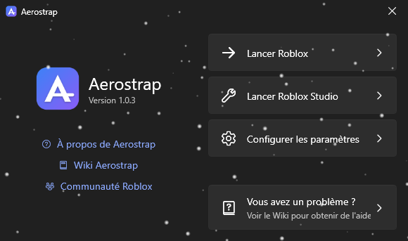
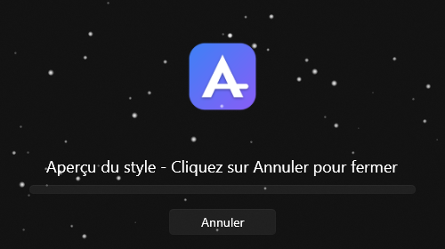
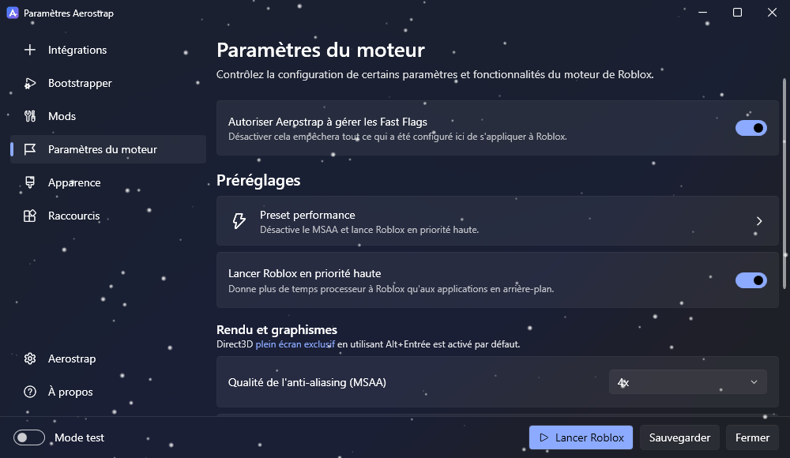
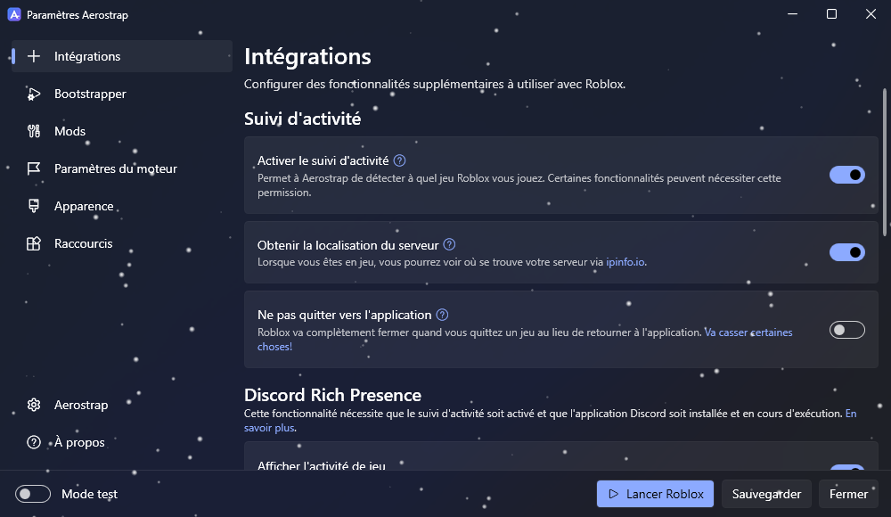
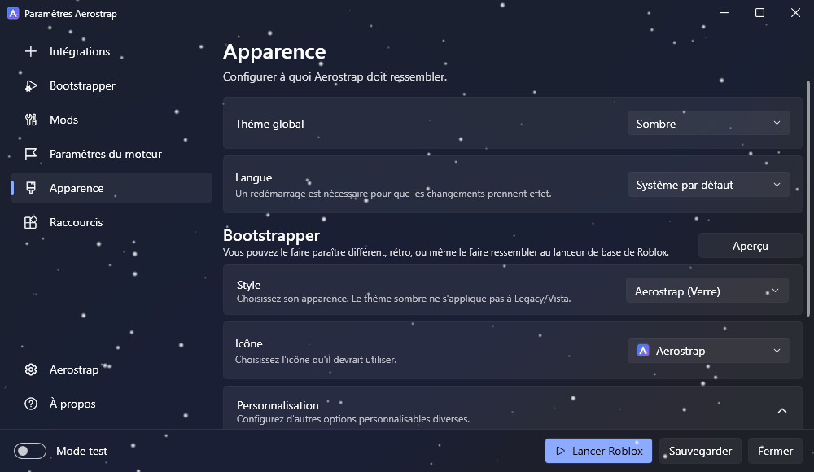

<p align="center">
  
</p>

<h1 align="center">Aerostrap</h1>

<p align="center">
  Un launcher Roblox pour Windows, léger et facile à personnaliser.
</p>

<p align="center">
  <a href="https://github.com/noa15235/aerostrap/releases/latest"></a>
  <a href="https://github.com/noa15235/aerostrap/releases"></a>
  <a href="https://github.com/noa15235/aerostrap/actions/workflows/build.yml"></a>
</p>

<p align="center">
  
  
</p>

Aerostrap prend la place du lanceur officiel. Quand tu cliques sur « Jouer » sur le site de Roblox, c'est lui qui s'ouvre : il installe ou met à jour Roblox, applique tes réglages, puis lance le jeu.

## Ce qu'il fait

- **Rich Presence Discord** : le jeu, son icône, le temps passé dessus et un bouton pour rejoindre ton serveur. Tu peux réécrire les deux lignes avec `{game}`, `{creator}`, `{placeId}` et `{jobId}`.
- **Preset performance** : un clic pour couper le MSAA et lancer Roblox en priorité haute.
- **Fast Flags** : les réglages de rendu encore autorisés par Roblox, plus un éditeur pour le reste.
- **Mods** : ancien curseur, anciens sons, polices et emojis.
- **Infos serveur** : la région du serveur sur lequel tu joues et l'historique de tes parties.
- **Interface** : thème clair ou sombre, une trentaine de langues, et de la neige qui suit le taux de rafraîchissement de ton écran.

Aerostrap n'envoie aucune statistique, nulle part.

## Installation

1. Télécharge `Aerostrap.exe` depuis la [dernière release](https://github.com/noa15235/aerostrap/releases/latest).
2. Lance-le et suis l'installation.
3. C'est tout. Les liens « Jouer » du site passent maintenant par Aerostrap.

Il faut Windows 10 ou 11 et le [.NET 6 Desktop Runtime](https://dotnet.microsoft.com/download/dotnet/6.0).

Si Roblox est déjà installé depuis le site ou le Microsoft Store, désinstalle-le. Sinon il reprend les liens « Jouer » à chaque mise à jour et Aerostrap ne s'ouvre plus.

## Aperçu

<p align="center">
  
</p>

<p align="center">
  
  
</p>

## Compiler

Il faut le [SDK .NET 6](https://dotnet.microsoft.com/download/dotnet/6.0).

```
git clone https://github.com/noa15235/aerostrap
cd aerostrap
dotnet publish Aerostrap/Aerostrap.csproj -c Release -r win-x64 --self-contained false -p:PublishSingleFile=true
```

L'exécutable se retrouve dans `Aerostrap/bin/Release/net6.0-windows/win-x64/publish`.

## Un problème ?

Ouvre une [issue](https://github.com/noa15235/aerostrap/issues) en expliquant ce qui se passe. Joins le dernier fichier de `%LocalAppData%\Aerostrap\Logs`, ça aide beaucoup.

## Licence

[MIT](LICENSE)
